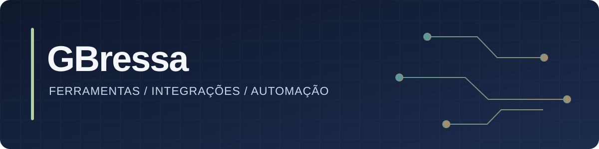

# Olá, eu sou GBressa

Crio ferramentas que simplificam tarefas do dia a dia e conectam serviços. Gosto de projetos com utilidade prática, documentação clara e interfaces que ajudam a entender o que está acontecendo.

## Projetos e explorações

| Projeto | O que faz |
| :--- | :--- |
| [mi-scale-garmin-bridge](https://github.com/GBressa/mi-scale-garmin-bridge) | Lê o peso de uma Mi Smart Scale 2 por Bluetooth e pode enviá-lo ao Garmin Connect. Projeto em Python. |
| [mdcli](https://github.com/GBressa/mdcli) | Fork de [fm1randa/mdcli](https://github.com/fm1randa/mdcli), um cliente de linha de comando não oficial para o Meu Dinheiro, feito com TypeScript e Bun. |

### No que estou interessado

Automação · integrações entre serviços · ferramentas de linha de comando · experiências simples para fluxos complexos.
